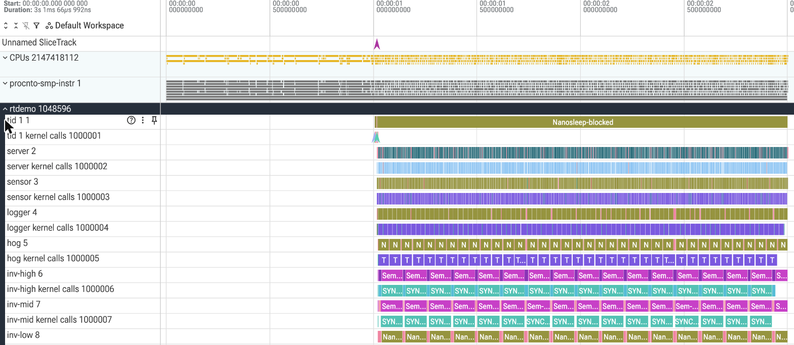
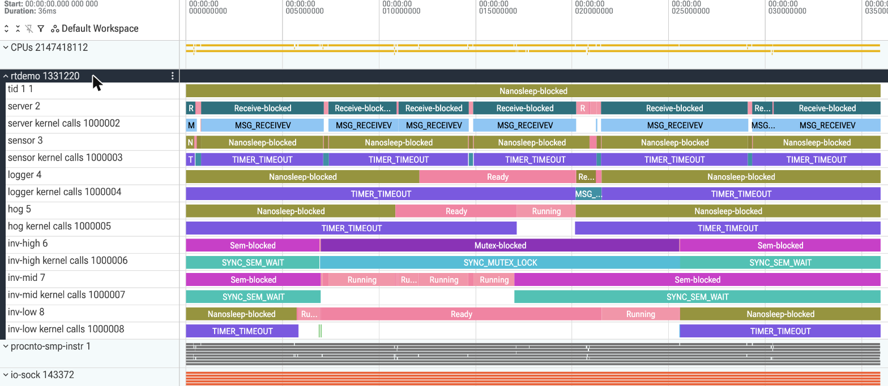
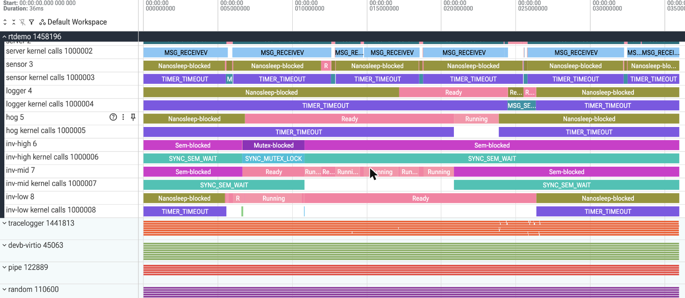

# kevscope

kevscope turns a kernel event trace from QNX SDP 8.0 into a timeline you can open in a browser (Perfetto), and answers scheduling questions about it from the command line.

Built with help from Claude Code (Anthropic).

Repository: https://github.com/Khozhijon/kevscope | Demo video (2 min): https://youtu.be/d3WG5kz5NG0 | Tutorial: [docs/codelab.md](docs/codelab.md)



The `rtdemo` workload traced on QNX 8.0 (aarch64, QEMU) and opened in ui.perfetto.dev: one state track and one kernel-call track per thread.

One cycle of the priority inversion, exported with `convert --from ... --to ...`. `inv-high` (priority 18) is Mutex-blocked in `SYNC_MUTEX_LOCK`; `inv-low` holds the lock but is only Ready, because `inv-mid` (priority 12) is Running:



The same program with `PTHREAD_PRIO_INHERIT`: `inv-low` inherits priority 18 and runs at once, and `inv-mid` waits its turn:



## Why

QNX SDP 8.0 has no macOS host tools. The graphical view of a kernel trace, the System Profiler, lives in the Momentics IDE. None of the SDP's host tools run natively on a Mac, so a trace captured on a QNX target is hard to look at from there.

A kernel trace is the best view of a real-time system. It shows who ran, who waited, who sent a message to whom, and why. kevscope makes that view available in any browser and lets you query it from a script.

kevscope is a host tool. It reads the text that QNX's own `traceprinter` prints. It is written in Python 3.9+ with the standard library only. It was developed on an Apple-silicon Mac, but nothing in the Python is Mac-specific.

## What you get

Four commands. All of them ran and are covered by tests.

| Command | What it does |
|---|---|
| `convert` | Writes Trace Event JSON that ui.perfetto.dev opens. |
| `view` | Converts, serves the file once on 127.0.0.1:9001, and opens ui.perfetto.dev pointed at it. The trace does not leave the machine. |
| `stats` | Per-thread CPU time, run count, and Ready-to-Running latency (min, avg, p99 by nearest rank, max). |
| `blame` | For one thread, shows which threads ran on the CPU it was waiting for while it was Ready or Mutex-blocked. This finds priority inversions. |

The thread name for `blame` can be a thread name, part of "process: thread", or PID:TID.

`convert --from SEC --to SEC` exports only a time window, which is the quick way to look at one event up close. `blame --shares` prints counts and shares without durations.

### Example: `blame`

This output comes from the hand-written test fixture `tests/fixtures/synthetic_qnx8.txt`, not measured on QNX.

```bash
python3 -m kevscope blame tests/fixtures/synthetic_qnx8.txt --thread high
```

```
demo: high (pid 500 tid 4)

  Ready: 1 time, 128 ns in total, longest 128 ns at t=4.1 us
  nothing else ran on the CPU it was waiting for (not traced, or the wait was a hand-over between events)

  Mutex-blocked: 1 time, 2.6 us in total, longest 2.6 us at t=1.5 us
  meanwhile the CPU it was waiting for ran:
    demo: mid                                        2.0 us   80.0%
    demo: low                                        512 ns   20.0%
```

Read it like this: while `high` was blocked on a mutex, the CPU it needed ran `mid`, which does not hold the lock. That is a priority inversion.

### Example: `stats`

Also from the hand-written test fixture, not measured on QNX.

```
Trace length 5.1 us, 2 CPU(s), 4 threads, 0 message flows, 1 interrupts

process                thread               cpu time   runs wakeups    lat min    lat avg    lat p99    lat max
demo                   mid                    2.0 us      1       0       0 ns       0 ns       0 ns       0 ns
demo                   low                    1.8 us      3       2     512 ns     1.5 us     2.6 us     2.6 us
demo                   high                   896 ns      2       1     128 ns     128 ns     128 ns     128 ns
```

## Quick start

You already have a text file made by `traceprinter`. You need Python 3.9 or newer.

```bash
python3 -m kevscope convert trace.txt -o trace.json
```

Then open https://ui.perfetto.dev, choose "Open trace file", and pick `trace.json`.

```bash
python3 -m kevscope stats trace.txt
```

```bash
python3 -m kevscope blame trace.txt --thread NAME
```

`view` is a shortcut for convert plus open: `python3 -m kevscope view trace.txt`. See the limitations below before relying on it.

## Capture a trace on QNX 8.0

On the target, start the logger for N seconds. Wide mode (`-w`) also records thread priorities and more kernel-call arguments:

```bash
tracelogger -w -s N -f file.kev
```

Run your workload while it logs. Copy `file.kev` to the host. With the SDP host tools, print it as text:

```bash
traceprinter -f file.kev -o file.txt
```

Then use any kevscope command on `file.txt`. kevscope does not decode raw `.kev` files. QNX does not publish the binary layout, and a decoder written from guesses would be wrong. If you pass a `.kev` file, kevscope says so and asks for `traceprinter` output.

## Build and run the demo

The demo is `workload/rtdemo.c`, a small multi-threaded QNX program made to be traced.

- QNX version: QNX SDP 8.0 (QNX Everywhere), 8.0.0.
- Target: QEMU `virt` machine, aarch64le, image built with `mkqnximage`.
- Toolchain: `qcc -Vgcc_ntoaarch64le` (gcc 12.2.0), from the SDP Linux host tools, run in a linux/amd64 container on the Mac.

The full install, with every command and the pitfalls, is in [docs/codelab.md](docs/codelab.md). In short, once the SDP and image exist:

```bash
tools/qemu-run.sh
```

In a second terminal:

```bash
tools/demo.sh
```

`demo.sh` builds `rtdemo`, copies it to the target, traces it twice (`rtdemo -i` and `rtdemo -i -p`), and runs `blame` on `inv-high` for each trace.

What the real run showed, described without numbers because the QNX licence does not allow publishing measurements: without priority inheritance, most of `inv-high`'s mutex wait is spent with `inv-mid` on the CPU. With `PTHREAD_PRIO_INHERIT`, only the lock holder `inv-low` runs.

## Where QNX is used

This is the evidence of QNX use for the hackathon rules.

| File | What QNX API or tool it uses |
|---|---|
| `workload/rtdemo.c` | `ChannelCreate`, `ConnectAttach(_NTO_SIDE_CHANNEL)`, `MsgSend`, `MsgReceive`, `MsgReply`, `MsgError`, `MsgSendPulse`, pulses from `timer_create` with `SIGEV_PULSE_INIT`, `ThreadCtl(_NTO_TCTL_RUNMASK)`, `pthread_setname_np`, `trace_logf(_NTO_TRACE_USERFIRST ...)`, mutex protocol `PTHREAD_PRIO_NONE` or `PTHREAD_PRIO_INHERIT` |
| `workload/Makefile` | `qcc -Vgcc_ntoaarch64le` (QNX SDP 8.0 toolchain) |
| `docker/Dockerfile`, `docker/sdp.sh` | Installs QNX Software Center 2.0.4 (Linux build) and SDP 8.0 in a linux/amd64 container; runs `mkqnximage` and `traceprinter` |
| `tools/qemu-run.sh` | Boots the `mkqnximage` aarch64le image in QEMU |
| `tools/target.sh` | ssh and scp to the QNX target |
| `tools/trace-run.sh` | `tracelogger -w` on the target, `traceprinter` on the host |
| `tools/demo.sh` | Build, deploy, trace and analyse `rtdemo` on QNX 8.0 |
| `kevscope/textparse.py` | Parser for QNX 8.0 `traceprinter` output |

Observed on the author's Mac: the console line `QNX qnx-a64 8.0.0 2026/10/30-09:09:47EDT QEMU_virt aarch64le`, and `rtdemo` printing `rtdemo: ran 2 s on QNX, 7 threads, mutex without priority inheritance`.

`rtdemo` has these threads: server (priority 20), sensor (15), logger (8), hog (10). With `-i` it adds inv-low (5), inv-mid (12) and inv-high (18). All are pinned to CPU 0 so they compete.

The parser handles the QNX 8.0 forms found on a real capture: 64-bit `t:` cycle counts, a class column padded to 16, `INTERRUPT:INT_DELIVER` instead of `INT_ENTR`/`INT_EXIT`, `USREVENT` with text or data words, and thread states such as `THTRACEBUFFER`, `THMUON_MUTEX` and `THSEND_NOTIFY`. Unknown `TH*` states still become states. The older 32-bit format is also supported.

## Timeline layout

Confirmed by opening a real QNX 8.0 trace in ui.perfetto.dev.

- A "CPUs" group: for each CPU, a track of which thread ran, and a track of interrupt deliveries.
- One group per QNX process. Each thread has a state track (Running, Ready, Receive-blocked, Reply-blocked, Mutex-blocked, Nanosleep-blocked, Sem-blocked, ...) and under it a "thread kernel calls" track (MSG_SENDV, SYNC_MUTEX_LOCK, TIMER_TIMEOUT, ...).
- Flow arrows for message passing: MsgSend client to server receive, and server MsgReply to the client running again.
- User trace events (`trace_logf`) as global markers with their text.
- Thread names and priorities in slice details.

## How it works

```
traceprinter text -> decoder -> event model -> timeline -> exporter / analyses
```

- `kevscope/textparse.py` decodes the text into events.
- `kevscope/model.py` defines the event model.
- `kevscope/timeline.py` builds per-CPU and per-thread intervals, kernel calls, interrupts and message flows.
- `kevscope/perfetto.py` writes Trace Event JSON.
- `kevscope/stats.py` and `kevscope/blame.py` compute the reports.
- `kevscope/view.py` serves the JSON once for the Perfetto UI.
- `kevscope/kev.py` is a stub that refuses raw `.kev` files.
- `kevscope/__main__.py` is the command line.

## What did not work, and limitations

- No raw `.kev` decoding. Use `traceprinter` first.
- HVF acceleration does not work. QNX's `startup-qemu-virt` asserts in `gic_v3.c` with `-accel hvf`, and QEMU 11 refuses GICv2 under HVF. The demo runs under TCG, which is slow but works.
- QEMU 11 no longer has the machine `virt-4.2` that `mkqnximage`'s own runner asks for. `tools/qemu-run.sh` uses `virt-8.2`.
- The `view` local-server path was not confirmed end to end. Chrome asks once for permission for ui.perfetto.dev to reach the local network, and that needs a human click. Opening the JSON with "Open trace file" was confirmed.
- Flow arrows were imported (Perfetto's SQL counts matched what was written) but were not inspected visually.
- Tested on one Mac only (Apple M5, macOS 27.2, Docker Desktop 29.9, QEMU 11.1.3).
- Logins to the test VM sometimes failed with "Permission denied" when SSH offered the host's own keys first. `tools/target.sh` now uses password login only and retries copies.
- No measurements from QNX are published here, because of the licence terms.

## Tests

```bash
python3 -m unittest discover -s tests -t .
```

52 tests pass. They cover the timeline, stats and exporter, the old-format decoder, the QNX 8.0 line forms, time-window export, `blame` and the command line. The fixtures are hand-written, not captures.

## Licence and notices

- kevscope is licensed under Apache-2.0.
- The repository contains no QNX software, binaries, images, headers, documentation text or captured traces.
- You need your own free QNX licence (QNX Everywhere) to build and run the demo. Nothing here redistributes QNX software.
- QNX is a trademark of BlackBerry Limited. kevscope is an independent project, not affiliated with or endorsed by BlackBerry.
- Built with help from Claude Code (Anthropic).
